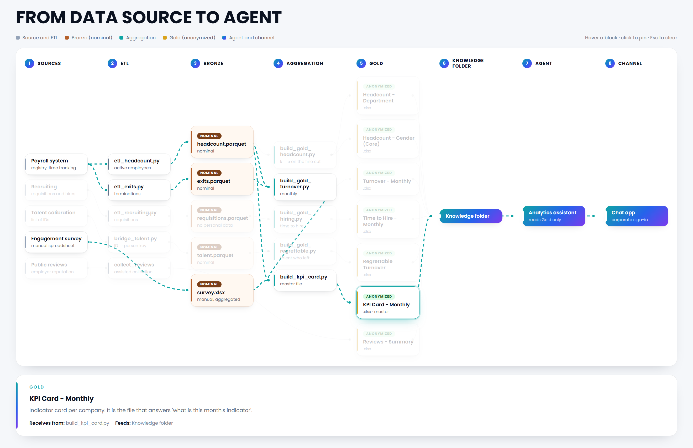

# People Analytics Catalog

[](https://github.com/Gustavo-Analytics/people-analytics-catalog/actions/workflows/ci.yml)

Português: [README.pt-BR.md](README.pt-BR.md)

Data engineering and AI agent patterns for People Analytics, demonstrated with **100% synthetic data** from a fictional company (Acme Retail Group).

> Focus: the **method**. No data, code, documents or names from any employer appear here. See [DISCLAIMER.md](DISCLAIMER.md).

[](https://gustavo-analytics.github.io/people-analytics-catalog/projects/01-ai-agent-data-lineage/)

_Interactive map (click to open). Select a block to see everything that feeds it and everything it feeds._

## Projects

| # | Project | What it shows | Status |
|---|---|---|---|
| 01 | [Data lineage of an AI agent](projects/01-ai-agent-data-lineage) | Interactive map of the 8 layers, from source to chat, with Bronze/Gold and k-anonymity | Done |
| 02 | [ETL and consolidation pattern](projects/02-etl-consolidation-pattern) | Runnable Bronze → Gold pipeline: monthly consolidation, dedup, ID → key bridge, small-group suppression | Done |
| 03 | [Staged assistant architecture](projects/03-staged-assistant-architecture) | Answer cheap first (pandas), call an LLM only when needed | Done |
| 04 | [SQL analytics layer](projects/04-sql-analytics-layer) | The same Gold queried with SQL in DuckDB: governed views, window functions, a privacy audit written in SQL | Done |

## Run the example

```bash
py synthetic-data/generate.py
py projects/02-etl-consolidation-pattern/src/consolidate.py
py projects/02-etl-consolidation-pattern/src/build_gold.py
py projects/03-staged-assistant-architecture/src/evaluate.py
py projects/04-sql-analytics-layer/src/warehouse.py turnover_ranking
```

Requires Python 3.10+ (`pip install -r requirements.txt`). On Linux/macOS use `python3` instead of `py`. Outputs go to `out/` (ignored by git).
Live map: https://gustavo-analytics.github.io/people-analytics-catalog/ (or open `projects/01-ai-agent-data-lineage/index.html` in a browser).

## Quality

```bash
pip install -r requirements-dev.txt
py tools/run_tests.py                                 # all tests
coverage run tools/run_tests.py && coverage report    # coverage; CI fails below 95%
ruff check .                                          # lint
mypy $(git ls-files '*.py')                           # types (bash; on PowerShell, pass the file list)
py tools/mutation_check.py                            # do the tests catch bugs?
```

- **Tests** cover the ETL (key normalization, deduplication, k-anonymity, standardized views, `n/a`, no person column in Gold), the staged assistant, the SQL layer, the data generator and the publication guard. One test is property-based (`hypothesis`): it checks the k-anonymity rule for any list of counts and any k.
- **Lint and types** run in CI on every Python file. Every public function needs a docstring and type annotations, and CI fails otherwise.
- **Do the tests catch bugs?** `tools/mutation_check.py` injects 14 deliberate defects into a copy of the repository, one at a time (for example: suppressing groups of exactly k, publishing turnover on the wrong scale, letting an indicator without a source reach the LLM) and checks that the tests fail for each. Today it catches all 14. It is a small hand-picked set, not a full mutation-testing tool.

## Safety of this repository

- `tools/guard.py` scans the repository for forbidden terms, valid CPF numbers, e-mail addresses, machine paths, embedded images and data files. Run it before every commit, or install the hook (`tools/pre-commit`).
- Synthetic data uses CPF numbers with an **intentionally invalid** check digit, so the guard can tell test data from real data.
- `.parquet`, `.xlsx` and similar files are in `.gitignore`.

## License

[MIT](LICENSE)

## Author

Gustavo, People Analytics. [LinkedIn](https://www.linkedin.com/in/gustavo-13p/)
