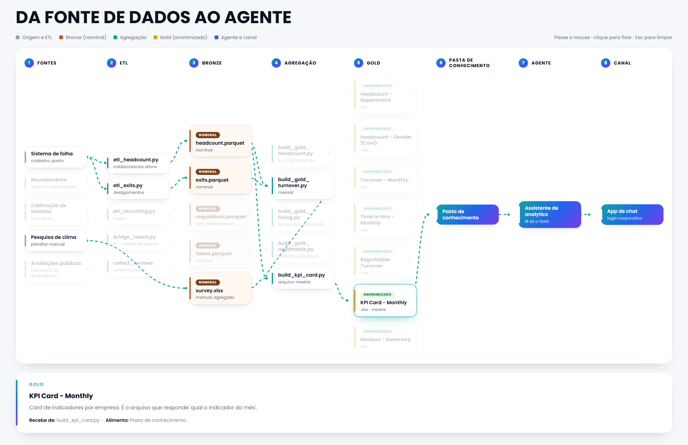

# People Analytics Catalog

[](https://github.com/Gustavo-Analytics/people-analytics-catalog/actions/workflows/ci.yml)

English: [README.md](README.md)

Padrões de engenharia de dados e de agentes de IA para People Analytics, demonstrados com **dados 100% sintéticos** de uma empresa fictícia (Acme Retail Group).

> Foco: o **método**. Nenhum número, nome, regra ou documento de empregador aparece aqui. Ver [DISCLAIMER.pt-BR.md](DISCLAIMER.pt-BR.md).

[](https://gustavo-analytics.github.io/people-analytics-catalog/projects/01-ai-agent-data-lineage/index.pt-BR.html)

_Mapa interativo (clique para abrir). Selecione um bloco para ver tudo o que o alimenta e tudo o que ele alimenta._

## Projetos

| # | Projeto | O que mostra | Status |
|---|---|---|---|
| 01 | [Linhagem de dados de um agente de IA](projects/01-ai-agent-data-lineage) | Mapa interativo das 8 camadas, da fonte ao chat, com Bronze/Gold e k-anonimato | Pronto |
| 02 | [Padrão de ETL e consolidação](projects/02-etl-consolidation-pattern) | Pipeline Bronze → Gold executável: consolidação mensal, dedup, ponte ID → chave, supressão de grupos pequenos | Pronto |
| 03 | [Arquitetura de assistente em estágios](projects/03-staged-assistant-architecture) | Responder barato primeiro (pandas), LLM só quando precisa | Pronto |

## Como rodar o exemplo

```bash
py synthetic-data/generate.py
py projects/02-etl-consolidation-pattern/src/consolidate.py
py projects/02-etl-consolidation-pattern/src/build_gold.py
py projects/03-staged-assistant-architecture/src/evaluate.py
```

Requer Python 3.10+ (`pip install -r requirements.txt`). No Linux/macOS use `python3` no lugar de `py`. As saídas vão para `out/` (ignorada pelo git).
Mapa online: https://gustavo-analytics.github.io/people-analytics-catalog/projects/01-ai-agent-data-lineage/index.pt-BR.html (ou abra `projects/01-ai-agent-data-lineage/index.pt-BR.html` no navegador).

## Segurança do próprio repositório

- `tools/guard.py` varre o repositório atrás de termos proibidos, CPF válido, e-mails, caminhos de máquina, imagens embutidas e arquivos de dado. Rode antes de todo commit, ou instale o hook (`tools/pre-commit`).
- Dados sintéticos usam CPFs com dígito verificador **inválido de propósito**, então o guarda consegue distinguir dado de teste de dado real.
- Arquivos `.parquet`, `.xlsx` e similares estão no `.gitignore`.

## Autor

Gustavo, People Analytics. [LinkedIn](https://www.linkedin.com/in/gustavo-13p/)

## Licença

[MIT](LICENSE)
